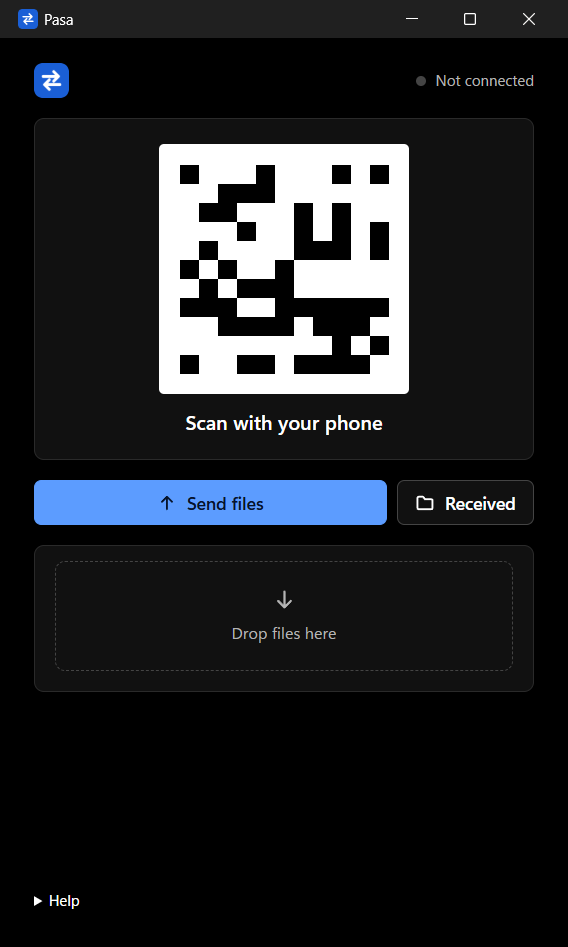
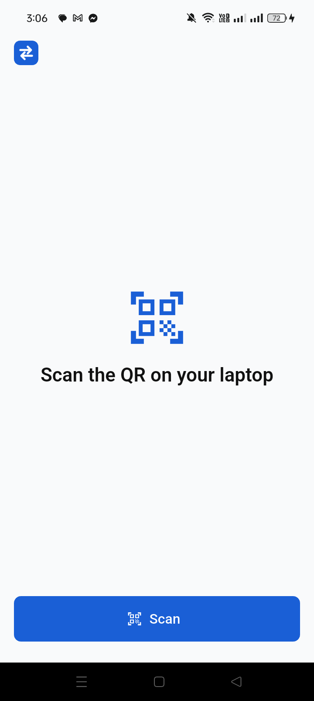

# Pasa

Move files between your Android phone and your Windows laptop. No internet, no cables, no account: the laptop makes its own Wi-Fi network for the phone.

**Live demo:** [Download v0.1.0 (Windows installer + Android APK)](https://github.com/dewdew-del/pasa/releases/tag/v0.1.0)

<p>
  
  
</p>

## How to use

1. Open **Pasa** on the laptop. It shows a QR code.
2. Open **Pasa** on the phone and tap **Scan QR code**. Next time, just tap **Reconnect**.
3. Send files from either side:
   - Phone: tap **Send files**. They land in the laptop's `Downloads\Pasa`.
   - Laptop: press **Send files** or drop files on the window. They land in the phone's `Download/Pasa` on their own.

Same Wi-Fi? They connect directly. Not on the same Wi-Fi? The phone joins the laptop's own **Pasa** network: Android asks once, tap **Connect**. No hotspot to turn on, and the phone keeps its mobile data.

## Can't connect?

- Wi-Fi off? Pasa turns the laptop's Wi-Fi on by itself; on the phone, tap the Wi-Fi switch when it pops up.
- Allow Pasa in Windows Firewall. The installer adds this rule for you; when running from source, tick both **Private** and **Public** on the firewall prompt.
- On the laptop, **Forget phones** makes old phones scan again.

## How it works

The laptop app runs a small HTTP server on port 47800. The QR holds the laptop's local addresses, the port and a random 256-bit pairing key; every request must carry that key. Files are streamed in chunks, so large videos never load into memory, and a half-received file is always deleted.

| Part | Stack |
|---|---|
| Laptop | Tauri 2 (Rust + axum), plain HTML/CSS/JS |
| Phone | Flutter (Android 11+) |

## Build from source

Laptop (needs Rust and Node):

```bash
cd desktop && npm install && npm run tauri build
```

Phone (needs Flutter):

```bash
cd mobile && flutter build apk --release --split-per-abi
```

Tests:

```bash
cd desktop/src-tauri && cargo test
```

```bash
cd mobile && flutter test
```

## Credits

Built by dewdew-del. Icons are hand-drawn SVG and Material Icons.
